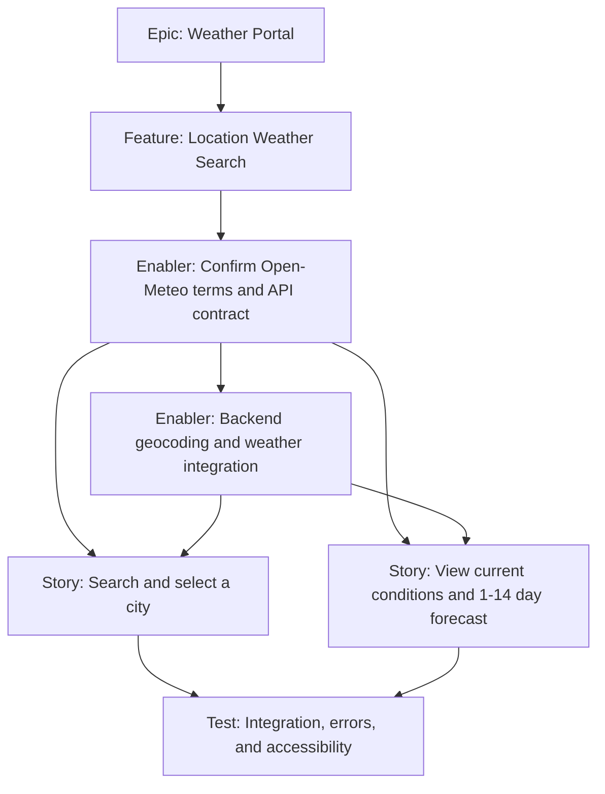

# Weather Data Portal — Issue Creation Checklist

This is a draft breakdown for creating GitHub issues; it does not create issues. Confirm Open-Meteo's non-commercial eligibility and resolve remaining decisions in the [project plan](./project-plan.md) before assigning implementation work. Estimates and labels are proposals and should be adjusted to the repository's existing conventions.

## Pre-creation decisions

- [ ] Confirm the app is non-commercial and eligible for Open-Meteo's free/open-access API; otherwise select a commercial plan/provider.
- [ ] Confirm MVP requirements: city suggestions dropdown, current conditions, 1–14 forecast days (default 7), and metric units.
- [ ] Agree on displayed fields: current conditions; daily status, high/low, and maximum UV; hourly local-time status, temperature, feels-like temperature, and humidity data; normalized API contract, validation, and error responses.
- [ ] Confirm Redis is available for shared response caching and provider quota tracking; Docker Compose must start Redis.
- [ ] Confirm Open-Meteo attribution and local configuration; do not put real secrets in issues.
- [ ] Confirm issue labels, parent/child linking method, and project board availability.

## Proposed hierarchy and dependencies

## Issue drafts

### Epic: Weather Portal

- [ ] **Labels:** `epic`, `priority-high`, `value-high`
- **Estimate:** `M`
- **Business value:** Provide visitors with an accessible way to find current weather and a user-selected 1–14 day forecast for a selected city.

**Acceptance criteria**

- [ ] Visitors can search cities using a suggestion dropdown, choose 1–14 forecast days (default 7), and view current conditions plus the requested number of forecast days.
- [ ] The provider integration is mediated by the backend and no credentials are exposed to the browser.
- [ ] Forecast days show human-readable weather status and metric high/low temperatures; hourly details include condition, temperature, feels-like temperature, daily maximum UV, and one average-humidity summary below UV.
- [ ] Redis-backed caching and shared provider quota tracking work in the documented Docker Compose setup.
- [ ] Invalid searches and provider/network failures have clear user feedback.
- [ ] Core flows are tested, accessibility is reviewed, and the frontend build succeeds.
- [ ] Provider eligibility, required attribution, and local setup are documented.

**Definition of done:** All child work is complete and verified. Only Gilfoyle Code Review Mode performs code review. Findings are handed to the owner of the affected area; that owner fixes only their scope and runs its tests/build before returning the change for independent reviewer re-review. Repeat until approved or accepted residual findings are documented.

### Feature: Location Weather Search

- [ ] **Labels:** `feature`, `priority-high`, `value-high`, `frontend`, `backend`
- **Estimate:** `M`
- **Parent:** Weather Portal epic
- **Blocked by:** Open-Meteo eligibility/terms and API contract

**Description:** Let visitors search and select a city from suggestions, choose 1–14 forecast days, then view current conditions and daily/hourly forecast details in metric units through the existing React frontend and Express API.

**Acceptance criteria**

- [ ] Selecting a city suggestion returns and displays weather for that selected location.
- [ ] The selected 1–14 local forecast days show weather status, high/low temperatures in °C, and daily maximum UV.
- [ ] Per-day hourly detail shows local time, condition, temperature, feels-like temperature, and a current-hour indication when available.
- [ ] Humidity is shown once as a daily average below maximum UV in the hourly detail, not on each hourly row.
- [ ] Redis provides shared caching and provider quota tracking in the Docker Compose setup.
- [ ] Search, loading, empty, success, and failure states are understandable.
- [ ] Metric units, dates, and location context are visible; weather condition is not conveyed by color or icon alone.
- [ ] Open-Meteo attribution is displayed as required.
- [ ] Keyboard and assistive-technology use and mobile/desktop layouts are reviewed.

### Enabler: Confirm Open-Meteo eligibility and define API contract

- [ ] **Labels:** `enabler`, `priority-high`, `value-high`, `api`
- **Estimate:** `2` points
- **Dependencies:** None; blocks backend integration and live frontend integration.

**Tasks**

- [ ] Confirm the app's non-commercial eligibility and Open-Meteo free-access terms, limits, and attribution.
- [ ] Specify city suggestion fields and selection behavior, 1–14 day forecast fields, hourly fields, daily maximum UV, average-humidity display behavior, and metric units.
- [ ] Specify frontend-facing requests, normalized responses, validation, and error behavior.
- [ ] Specify Redis cache TTLs and canonical keys for location and weather responses.
- [ ] Document configuration and attribution without recording secret values.

**Acceptance criteria**

- [ ] Open-Meteo free/open-access terms are approved for the intended use, or a suitable paid/commercial provider is selected.
- [ ] The normalized API contract and expected error cases are documented and agreed.
- [ ] Provider configuration and attribution requirements are known.

### Enabler: Implement server-side geocoding and weather integration

- [ ] **Labels:** `enabler`, `priority-high`, `value-high`, `backend`, `api`
- **Estimate:** `5` points
- **Blocked by:** Open-Meteo eligibility/terms and API contract

**Tasks**

- [ ] Add a validated Express endpoint under `/api` that returns city suggestions using Open-Meteo Geocoding API.
- [ ] Add a validated weather endpoint that accepts coordinates from a selected city and calls Open-Meteo Forecast API.
- [ ] Normalize and validate provider responses before returning them to the frontend.
- [ ] Handle invalid input, no result, timeouts, upstream errors, rate limits, and malformed responses explicitly.
- [ ] Include hourly `humidityPercent` as a value from 0 to 100 or `null` when unavailable, alongside local time, temperature, feels-like temperature, and weather condition.
- [ ] Cache successful normalized responses in Redis for 24 hours (locations) and 10 minutes (weather), using canonical keys; cache hits bypass provider quota checks.
- [ ] Include Redis in Docker Compose for shared caching and quota tracking, and document the behavior when Redis is not configured for local development.
- [ ] Ensure cache read/write failures are logged and do not fail otherwise successful upstream responses.
- [ ] Document Docker Compose startup/shutdown, service health, logs, ports, and local configuration.
- [ ] Avoid exposing provider internals in client responses; no API key is required for the recommended free endpoint.

**Acceptance criteria**

- [ ] Valid requests return the agreed normalized response.
- [ ] Invalid requests and upstream failures return deliberate, safe responses.
- [ ] No provider credentials are exposed in frontend assets, API responses, or logs.
- [ ] Existing `/api/health`, backend port behavior, and Vite `/api` proxy continue to work.
- [ ] Redis-backed caching and provider quota tracking operate in Docker Compose with the documented TTLs and key canonicalization.
- [ ] Backend success and failure cases are covered by tests or documented verification.

### Story: Search for and select a city

- [ ] **Labels:** `user-story`, `priority-high`, `value-high`, `frontend`
- **Estimate:** `3` points
- **Blocked by:** API contract and backend geocoding/weather endpoints

**Story:** As a visitor, I want to type a city and select a matching dropdown suggestion so that I can see weather for the intended location.

**Tasks**

- [ ] Implement a labeled, keyboard-operable accessible combobox/listbox for city suggestions.
- [ ] Debounce queries and fetch suggestions through the relative `/api` path.
- [ ] Identify ambiguous city names with region/country where available.
- [ ] Load weather only after selection; distinguish loading, no-result, invalid-input, and request-failure states.
- [ ] Ensure a late response from earlier input cannot replace the latest suggestions.
- [ ] Announce request status/errors accessibly without unexpectedly moving focus.

**Acceptance criteria**

- [ ] The input has an accessible name and suggestions can be navigated/selected by keyboard.
- [ ] The selected location is identified with region/country where available.
- [ ] Free-form text alone does not trigger a weather success state; a suggestion must be selected.
- [ ] Loading and failure feedback is perceivable to assistive technology.

### Story: View current conditions and selected-length forecast

- [ ] **Labels:** `user-story`, `priority-high`, `value-high`, `frontend`
- **Estimate:** `3` points
- **Blocked by:** API contract and backend weather endpoint; integrate with the city selection flow

**Story:** As a visitor, I want current weather status and a selected-length 1–14 day forecast with daily and hourly details in metric units so that I can understand the weather for the selected city.

**Tasks**

- [ ] Display current temperature and human-readable weather status.
- [ ] Display the requested 1–14 local-calendar forecast days with human-readable status, daily high/low temperatures in °C, and daily maximum UV.
- [ ] Provide hourly details for each forecast day with local time, condition, temperature, feels-like temperature, and a current-hour indication when available.
- [ ] Show one average-humidity summary beneath maximum UV, averaged from available hourly humidity values; do not show humidity on each hourly row.
- [ ] Use metric units for any additional displayed measurements and clearly label units, dates, and selected city.
- [ ] Provide textual weather descriptions for any decorative weather icons.
- [ ] Represent unavailable optional data without inventing values.

**Acceptance criteria**

- [ ] Displayed conditions and exactly the requested 1–14 forecast days correspond to the selected city.
- [ ] Each forecast day shows weather status, high/low, maximum UV, and clearly labeled units/dates.
- [ ] Hourly popup shows local times, conditions, temperature, feels-like temperature, and the current hour when available.
- [ ] Humidity appears once as an average beneath UV, or as unavailable when no hourly values are present.
- [ ] Weather information is not conveyed by color or icon alone.
- [ ] Missing data is distinguished from a valid measurement.

### Test: Integration, error handling, accessibility, and responsive behavior

- [ ] **Labels:** `test`, `priority-high`, `value-high`, `testing`, `accessibility`
- **Estimate:** `3` points
- **Blocked by:** Backend endpoint and frontend search/display flows

**Tasks**

- [ ] Verify city search, selected-location weather success, invalid input, no-result, timeout, provider error, and rate-limit behavior.
- [ ] Verify frontend loading, success, empty, error, and repeated-search behavior.
- [ ] Verify forecast day choices 1, 7, and 14; reject out-of-range values.
- [ ] Verify hourly popup content, current-hour indication, UV row, average-humidity position, and missing-humidity behavior.
- [ ] Review keyboard interaction, labels, focus, status announcements, and contrast against `.github/instructions/a11y.instructions.md`.
- [ ] Check narrow and wide viewport layouts.
- [ ] Run frontend automated tests and production build; add a frontend test script if none exists. Run backend `npm test`.
- [ ] Start the complete Docker Compose stack and smoke-test Redis, health, city search, weather lookup, and a visible failure state.
- [ ] Route code-review findings to the frontend or backend owner as appropriate; require owner tests/build, then return changes to Gilfoyle Code Review Mode for independent re-review.

**Acceptance criteria**

- [ ] Normal and expected failure paths are verified.
- [ ] The required owner-specific tests/builds pass, and the Docker Compose integration smoke test passes.
- [ ] Accessibility review identifies no known blocking issues.
- [ ] Frontend build and backend checks pass.
- [ ] Provider setup and local development documentation are updated.
- [ ] Code review is performed only by Gilfoyle Code Review Mode; any owner fixes have been verified by that reviewer after the owner ran the relevant checks.

## Prioritization and sizing

All proposed work is P1 / high value because it delivers the MVP or is a prerequisite for it. Estimates use the Fibonacci story-point scale; the epic and feature use t-shirt sizing. Re-estimate after Open-Meteo eligibility and the API contract are confirmed.

## GitHub project setup (if used)

- Suggested statuses: Backlog, Ready, In Progress, In Review, Testing, Done.
- Suggested fields: Priority, Value, Component, Estimate, and Parent/Epic.
- Create the epic and feature first, then the Open-Meteo eligibility/API-contract enabler. Create implementation and test issues with explicit blocking relationships.

## Definition of done

- [ ] Acceptance criteria for the issue are met and reviewed.
- [ ] The frontend or backend owner runs the relevant test script; frontend changes also pass the production build.
- [ ] Expected failure paths are verified.
- [ ] Only Gilfoyle Code Review Mode performs code review. Findings are handed to the owner of the affected app; the owner fixes within their scope, runs tests/build, and returns changes for independent reviewer re-review. Repeat until approved or accepted residual findings are documented.
- [ ] Accessibility and responsive behavior are reviewed for user-facing work.
- [ ] No provider secrets are committed, exposed to the browser, or logged.
- [ ] Required Open-Meteo attribution is present.
- [ ] Relevant setup and provider documentation is updated.
