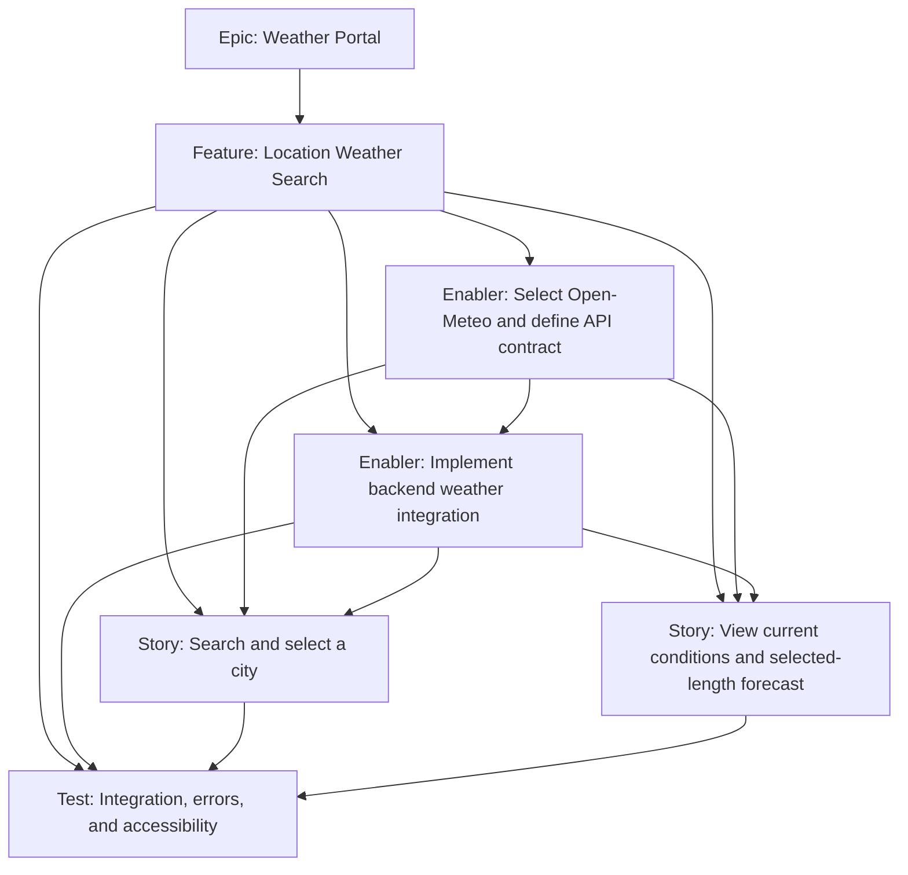

# Weather Data Portal — Project Plan

## Project overview

Add a weather portal to the existing React/Vite frontend, backed by the existing Express API. Visitors will enter a city or location using an accessible suggestion dropdown, choose a forecast length from 1 to 14 days (default 7), and see current weather plus a daily forecast. The backend will integrate with Open-Meteo so the frontend remains decoupled from provider-specific response details.

### Planning assumptions

- Location input is a city/place search with matching choices in a dropdown; users select a result before loading its weather. Browser geolocation is out of scope.
- The frontend has two user-facing controls: a city/location text box with selectable suggestions, and a forecast-days dropdown with values 1–14 and default 7.
- Show current temperature and human-readable conditions, plus one forecast entry per requested day with date, human-readable weather status, and daily high/low temperatures. Each day also provides an hourly detail popup with local-time conditions, temperature, feels-like temperature, daily maximum UV, and one average-humidity summary.
- Use standard metric units: °C for temperature, km/h for wind, and mm for precipitation where displayed. Make units explicit.
- No accounts, saved locations, alerts, or historical weather in the MVP.
- Redis is required for shared response caching and provider quota tracking. Docker Compose starts Redis with the application. Cache successful normalized location and weather API responses for 24 hours and 10 minutes respectively. Canonicalize location keys by trimming and case-folding the query; canonicalize weather keys with numeric latitude, longitude, and forecast-day values. Cache hits bypass upstream quota checks. Cache read/write failures are logged and do not turn an otherwise successful upstream response into an error.
- **Provider: Open-Meteo free/open-access API.** Its current terms explicitly include educational content as an eligible non-commercial use, so this tutorial project qualifies while it remains non-commercial (no subscriptions, advertising, or commercial promotion). It requires CC BY 4.0 attribution, is rate-limited to fewer than 10,000 calls/day, 5,000/hour, and 600/minute, and has no uptime guarantee. Commercial deployment requires a paid plan or another commercially licensed provider.

### Success criteria

- A visitor can enter a city/place, select an unambiguous dropdown result, choose 1–14 forecast days (default 7), and receive current conditions plus the requested number of daily forecasts when data is available.
- Each forecast day shows a date, human-readable weather status, and metric high/low temperatures. Its hourly detail popup includes local-time conditions, temperature, feels-like temperature, maximum UV, and one average-humidity value.
- Invalid locations, network failures, provider errors, and rate limits result in understandable UI feedback.
- Provider credentials are never sent to or embedded in the browser bundle.
- Frontend and backend builds/verification pass, and the core success and failure flows are tested.
- The portal is usable by keyboard and assistive technology and works at mobile and desktop widths.

### Ownership and responsibilities

| Scope | Owner | Responsibility |
|---|---|---|
| Overall project and delivery lead / code reviewer | Gilfoyle Code Review Mode | Coordinate delivery, resolve cross-app decisions, conduct the code review, review integration, and confirm the release gate. |
| Frontend | Expert React Frontend Engineer | Own the React/Vite UI, accessible location search and forecast controls, weather presentation, and frontend verification. |
| Backend | DevOps Expert | Own the Express API, Open-Meteo integration, API contract definition, validation and error handling, local Docker setup for both apps, and backend verification. |
| API contract | DevOps Expert, with the frontend owner consulted and overall lead resolving cross-app decisions | Define and document the request/response contract using standard HTTP API conventions before implementation; coordinate agreement with the frontend owner. |
| Provider decisions | Gilfoyle Code Review Mode, with the backend owner consulted | Confirm provider eligibility and resolve project-level provider decisions. |
| Integration and end-to-end testing | Gilfoyle Code Review Mode, with frontend and backend owners contributing | Coordinate cross-app verification; frontend and backend owners validate their respective flows and fix issues in their areas. |

These are role assignments, not named individuals or schedule commitments. The overall lead remains accountable for the plan, while implementation ownership stays with the relevant frontend or backend owner.

**Change boundary:** The frontend owner edits application code, tests, configuration, and dependencies only in `frontend/`; the backend owner edits those only in `backend/`. Neither owner changes files owned by the other. When a change crosses the API or UI boundary, the requesting owner describes the required behavior and asks the other owner to implement that portion; Gilfoyle coordinates cross-app decisions. Both owners may inspect either app and run its tests/builds for verification.

### Project Definition of Done and review workflow

- The only code reviewer is Gilfoyle Code Review Mode; implementation owners do not substitute self-review for this review.
- Code-review findings are handed to the owner of the affected area: frontend findings to Expert React Frontend Engineer and backend findings to DevOps Expert. Cross-app findings are split into owner-scoped fixes.
- Each owner changes only their assigned area and runs its verification before returning the change and results to the code reviewer. The frontend owner runs frontend tests and `npm run build`; a frontend test script must be available for the test run. The backend owner runs `npm test`.
- After owner verification, Gilfoyle independently re-reviews the changes. Any remaining findings repeat the owner-fix, owner-test, and reviewer re-review cycle.
- Delivery is done only when acceptance criteria are met, required owner tests/builds pass, the code reviewer approves or documents accepted residual findings, and relevant documentation is updated.

### Milestones

1. Open-Meteo terms and attribution confirmed; MVP requirements and API contract agreed.
2. API contract agreed; backend weather endpoints and local Docker setup implemented.
3. Search and weather display integrated in the frontend.
4. Error, accessibility, responsive, and integration checks completed.

## Work item hierarchy

## Work items

### Epic: Weather Portal

- **Priority / value:** P1 / High
- **Estimate:** M
- **Outcome:** Deliver an accessible, reliable weather lookup experience backed by a third-party weather service.
- **Acceptance criteria:**
  - Users can select a location, choose 1–14 forecast days, and view current conditions plus the requested forecast.
  - Weather and city lookup are mediated by the backend, and errors are handled end to end.
  - Accessibility and responsive checks are completed.
- **Definition of done:** All linked work items meet the [Project Definition of Done and review workflow](#project-definition-of-done-and-review-workflow), acceptance criteria are met, verification passes, and setup/provider configuration documentation is updated.

### Enabler: Select Open-Meteo and define API contract

- **Priority / value:** P1 / High
- **Estimate:** 2 points
- **Dependencies:** None; blocks live backend integration and frontend data integration.
- **Owner:** DevOps Expert
- **Tasks:**
  - Use the free/open-access API for this educational project while it remains non-commercial; review its rate limits, CC BY 4.0 attribution, and lack of uptime guarantee.
  - Define the location suggestion behavior, selectable forecast length (1–14 days, default 7), standard metric units, daily forecast fields, and accessible keyboard interaction.
  - Define and document the final API contract before frontend/backend integration, following standard HTTP API conventions: HTTP methods and paths, query parameters, success response schemas, validation rules, status codes, and a consistent client-safe error shape with machine-readable codes and messages.
  - Review the contract with the frontend owner and get cross-app agreement from the overall lead before parallel implementation.
- **API contract:**
  - The two visible frontend controls are `location` (typed query that must resolve to a selected suggestion) and `forecastDays` (integer 1–14, default 7).
  - City suggestions use `GET /api/locations?query={location}`. A successful response is `{ "locations": [...] }`; each location contains `id` (integer or `null`), `name` (string), `region` and `country` (string or `null`), and numeric `latitude` and `longitude`. A valid search with no matches succeeds with HTTP 200 and `{ "locations": [] }`.
  - Weather uses `GET /api/weather?latitude={latitude}&longitude={longitude}&forecastDays={forecastDays}` with coordinates from the selected suggestion; coordinates are selection data, not another user-entered field. `forecastDays` is an integer from 1 to 14 and defaults to 7.
  - The normalized weather response contains the forecast location's IANA `timezone`, `current.temperatureC`, `current.weatherCode`, and `current.weatherDescription`, plus `daily[]` entries with `date`, `weatherCode`, `weatherDescription`, `temperatureMaxC`, `temperatureMinC`, and `uvIndexMax`. Each daily entry also contains `hourly[]` local-time entries with `time`, `temperatureC`, `feelsLikeC`, `humidityPercent`, `weatherCode`, and `weatherDescription`. `humidityPercent` is a number from 0 to 100 or `null` when unavailable. The UI computes one average from available hourly humidity values for the day and displays it beneath maximum UV, not on each hourly row. UV is the daily maximum; temperature values are °C. Any displayed wind speed is in km/h and precipitation in mm.
  - Invalid requests and upstream failures return `{ "error": { "code": "...", "message": "..." } }` with a safe, human-readable message. Invalid location query (2–100 characters), coordinates, or `forecastDays` returns HTTP 400. Provider-request quota exhaustion returns HTTP 429 with `Retry-After`. Provider rate limiting or other upstream failures return a controlled HTTP 503 or 502 respectively; upstream timeouts return HTTP 504. Invalid upstream payloads return HTTP 502. A valid location search with no matches is not an error and returns the empty success response above.
- **Acceptance criteria:**
  - Open-Meteo's published terms are followed: free access is limited to non-commercial use, and educational content is explicitly listed as eligible.
  - The portal displays Open-Meteo attribution with a link, and documents the commercial-use boundary. The free API needs no credential.
  - The final method/path, location and weather response schemas, validation behavior, HTTP status codes, and error shape are documented and agreed by the backend and frontend owners.

### Story: Search for and select a city

- **Priority / value:** P1 / High
- **Estimate:** 3 points
- **Story:** As a visitor, I want to type a city and select a matching dropdown suggestion so that the weather is for the place I intended.
- **Dependencies:** Provider/API contract; backend weather endpoint.
- **Tasks:**
  - Add a labeled city/location text box with a keyboard-operable accessible combobox/listbox suggestion dropdown.
  - Use the Geocoding API through a backend `/api` route; return city, region where available, country, and coordinates for selection.
  - Query after at least two characters, debounce input, and prevent stale responses from replacing suggestions for newer input.
  - Load weather only after the visitor selects a suggestion.
  - Add a labeled forecast-days dropdown with integer options 1–14, defaulting to 7, and use the selected value when requesting the forecast.
  - Display loading, no-suggestion, invalid-input, and request-failure states.
- **Acceptance criteria:**
  - The location input and forecast-days dropdown have accessible names; the location input supports keyboard navigation/selection of suggestions.
  - Suggestions distinguish same-named cities using region/country where available.
  - Weather is requested only for a selected result; free-form text is not treated as a selected location.
  - Forecast requests use the selected location and requested day count; values outside 1–14 are rejected, and omitted day count defaults to 7.
  - Loading, no-result, and error updates are accessible and do not move focus unexpectedly.

### Story: View current conditions and forecast

- **Priority / value:** P1 / High
- **Estimate:** 3 points
- **Story:** As a visitor, I want current conditions and a forecast for my selected number of days in metric units so that I can understand the weather for the selected location.
- **Dependencies:** Provider/API contract; backend weather endpoint; location search flow.
- **Tasks:**
  - Display current temperature and human-readable weather status.
  - Display the requested 1–14 local-calendar forecast days with a human-readable status and daily high/low in °C.
  - Provide a per-day hourly detail popup with local-time condition, temperature, and feels-like temperature; identify the current local hour when available.
  - Show the day's maximum UV and one average humidity summary beneath it. Calculate the average from available hourly humidity values, round it for display, and show unavailable when no values are available; do not repeat humidity on hourly rows.
  - Display visible Open-Meteo attribution with a link to the provider.
  - Use °C for temperatures, km/h for wind speed, and mm for precipitation if displayed; label units.
  - Make dates and selected location explicit; do not rely on color or icons alone.
  - Handle missing optional provider data without presenting fabricated values.
- **Acceptance criteria:**
  - Current conditions and exactly the requested number of forecast days (1–14) correspond to the selected location.
  - Each daily forecast includes weather status plus high and low temperatures; units and dates are clear.
  - Hourly details show local time, condition, temperature, feels-like temperature, and current-hour indication when available.
  - Maximum UV and a single average-humidity summary appear in the detail popup, with humidity below UV and not repeated in hourly rows.
  - Weather condition is conveyed in text as well as any decorative icon.
  - Missing/unavailable data is clearly distinguished from valid measurements.

### Enabler: Implement server-side weather service integration

- **Priority / value:** P1 / High
- **Estimate:** 5 points
- **Dependencies:** Open-Meteo eligibility/terms; the backend owner defines the API contract before endpoint implementation.
- **Owner:** DevOps Expert
- **Tasks:**
  - Define the final request/response contract using standard HTTP API conventions, then add Express endpoints under `/api` for city suggestions and weather by selected coordinates. The weather request accepts a validated `forecastDays` value from 1–14, defaulting to 7; the free Open-Meteo API does not require credentials.
  - Normalize provider responses into the API contract defined above.
  - Handle upstream timeouts, non-success responses, rate limits, and malformed data explicitly.
  - Avoid returning provider internals to clients; if a paid provider is selected, keep its credentials in backend environment configuration and never log them.
  - Cache only successful normalized API responses in Redis, using the documented 24-hour location and 10-minute weather TTLs.
  - Require Redis in the Docker Compose setup for shared response caching and provider quota tracking; document that running without Redis disables caching and uses process-local quota tracking.
  - Add local Docker configuration for both frontend and backend so the complete application can be built and started together with Docker Compose; ensure the frontend can reach the backend through the existing `/api` interface.
  - Document required local configuration, exposed ports, startup/shutdown commands, and how to inspect service health and logs.
- **Acceptance criteria:**
  - A valid request returns normalized weather data.
  - Invalid input and provider failures return deliberate, safe error responses.
  - No provider credentials are included in frontend assets or API responses (the recommended free endpoint does not require an API key).
  - The existing `/api/health` route and port/proxy behavior remain intact.
  - A documented Docker Compose command builds and starts both apps locally, and the frontend can successfully call the backend API.
  - With Redis available, successful normalized location and weather responses use the documented TTLs and canonical cache keys; cache read/write failures are logged and do not fail otherwise successful requests.
  - Docker Compose includes a healthy Redis service required for the containerized application and shared quota/caching behavior.
  - Local development without Redis remains supported as a degraded mode: response caching is disabled and provider quota tracking is process-local, not shared across backend instances.
  - Local setup does not require installing Node dependencies on the host beyond Docker and Docker Compose when using the containerized workflow.

### Test: Integration, error handling, accessibility, and responsive behavior

- **Priority / value:** P1 / High
- **Estimate:** 3 points
- **Dependencies:** Backend endpoint and frontend flows.
- **Tasks:**
  - The frontend owner establishes automated frontend test infrastructure and an app-local `npm test` script if one does not already exist, then automates the planned UI state, selection, hourly detail, and accessibility-relevant interaction cases.
  - Test backend success, invalid input, no-result, timeout, provider error, and rate-limit cases.
  - Test frontend loading, success, empty, error, and repeated-search behavior, including forecast day selections of 1, 7, and 14 and rejection of out-of-range values.
  - Verify each day's hourly detail popup, current-hour indication, daily maximum UV, and single average-humidity summary placement and unavailable-data behavior.
  - Verify keyboard navigation, labels, focus, status announcements, contrast, and responsive layout.
  - Start the complete application using the documented Docker Compose workflow and run a local smoke test covering service health, city search, a weather lookup, and a visible failure state.
  - Run frontend automated tests with `npm test`, the frontend production build with `npm run build`, and backend verification with `npm test`, using the documented local Docker environment where applicable.
- **Acceptance criteria:**
  - Tests cover the agreed normal and failure paths.
  - The frontend test script exists and automates the agreed frontend behavior scenarios.
  - Accessibility review follows `.github/instructions/a11y.instructions.md`; no known blocking issues remain.
  - Frontend production build succeeds and backend checks pass.
  - A reviewer can reproduce the local Docker startup and smoke test by following the documented instructions.
  - Provider configuration and local run instructions are documented.

## Dependencies and delivery order

1. Use Open-Meteo's free API for the non-commercial educational project; provide CC BY 4.0 attribution and respect published rate limits.
2. Backend owner defines and documents the standard API contract; implement backend city-geocoding and forecast endpoints.
3. Implement the accessible city dropdown and weather display against the agreed contract. UI scaffolding can proceed once the contract is agreed; live integration depends on the endpoints.
4. Backend owner provides Docker Compose setup for running both apps locally; verify the integrated application with a local smoke test.
5. Complete integration, error-path, accessibility, and responsive verification.
6. Update setup documentation and deliver.

## Risks and mitigations

| Risk | Mitigation |
|---|---|
| Project use becomes commercial, making Open-Meteo's free API ineligible | Keep the free integration limited to non-commercial educational use; switch to a paid plan or a provider with a suitable commercial license before monetizing or promoting a commercial product. |
| Provider limits or outages interrupt searches | Use the required Redis-backed response cache (24 hours for locations, 10 minutes for weather) to reduce repeated upstream calls; debounce city lookups, respect published rate limits, and return controlled errors when a cache miss reaches an unavailable provider. Redis must be available for shared caching and quota tracking. |
| Provider response changes or contains missing fields | Normalize and validate on the backend; test missing optional data and avoid fabricated values. |
| API credentials leak into client-side code or logs | Read credentials only in the backend; review built frontend assets and logging behavior. |
| Weather icon/color treatment is inaccessible | Include textual condition descriptions and validate contrast, keyboard use, and status announcements. |

## Out of scope for MVP

Accounts, saved locations, severe weather alerts, historical data, browser geolocation, multiple providers/fallbacks, and advanced map/radar views.

## Provider research

- [Open-Meteo pricing and free/open-access limits](https://open-meteo.com/en/pricing): free access is for non-commercial use, capped at 10,000 calls/day, 5,000/hour, and 600/minute, with no uptime guarantee; commercial use requires a subscription. Checked 2026-11-04.
- [Open-Meteo terms](https://open-meteo.com/en/terms): explicitly includes educational content among eligible non-commercial uses; prohibits commercial use of the free API and requires compliance with the rate limits and CC BY 4.0 license. Checked 2026-11-04.
- [Open-Meteo Geocoding API](https://open-meteo.com/en/docs/geocoding-api): location-name search returns matching locations (default 10); one-character searches return no results, so query from two characters onward.
- [Open-Meteo Forecast API](https://open-meteo.com/en/docs): supports current temperature/weather code, daily weather code and maximum/minimum temperatures, configurable forecast length, and metric units. Use Celsius, km/h, and mm.
